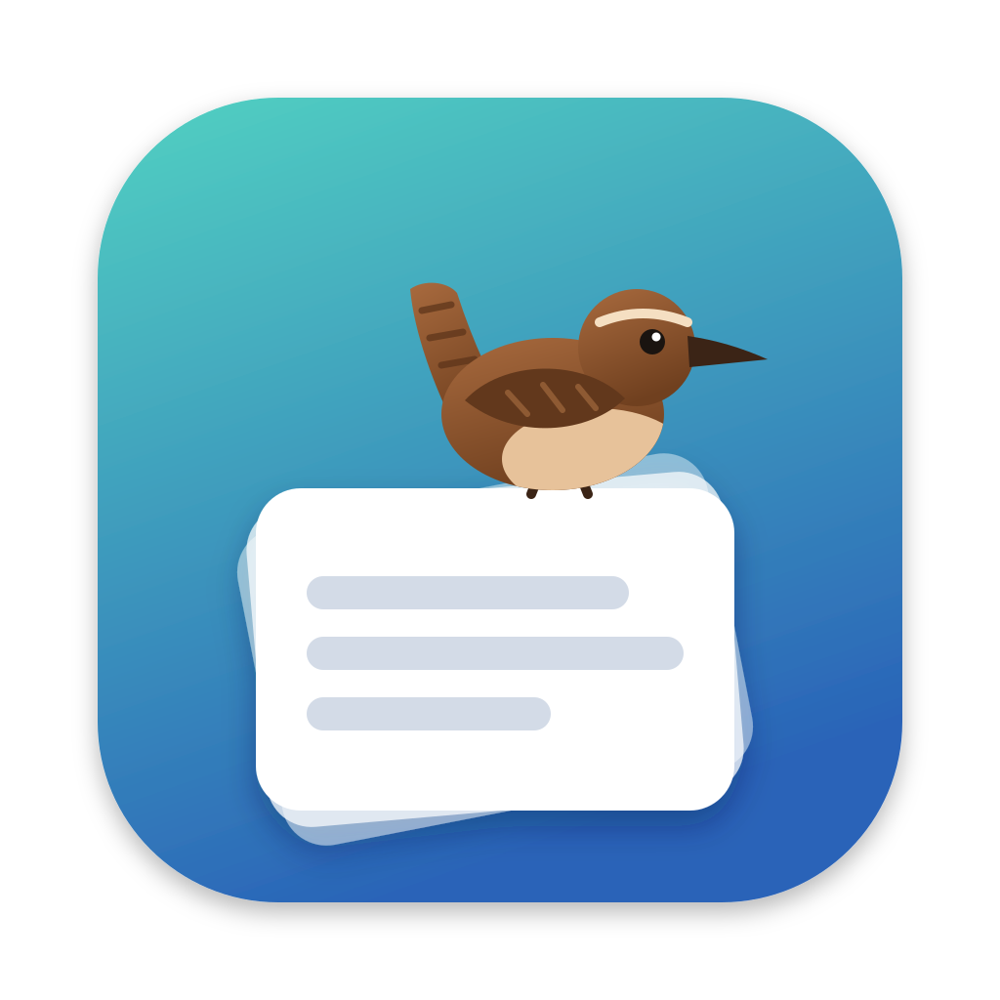
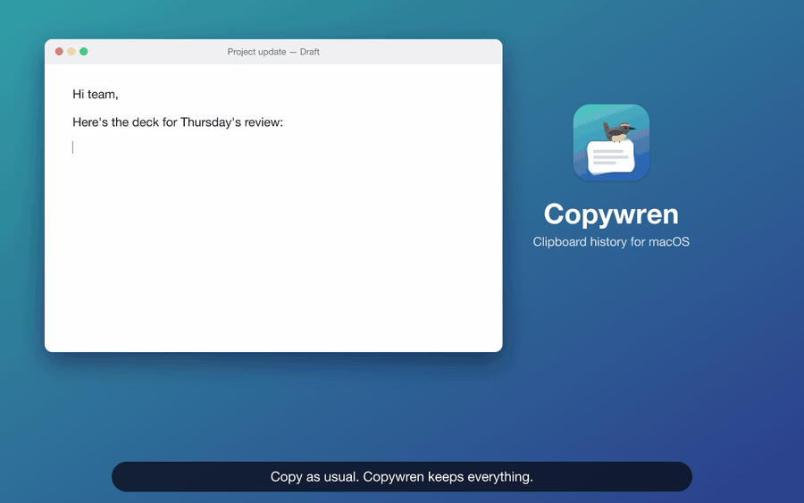
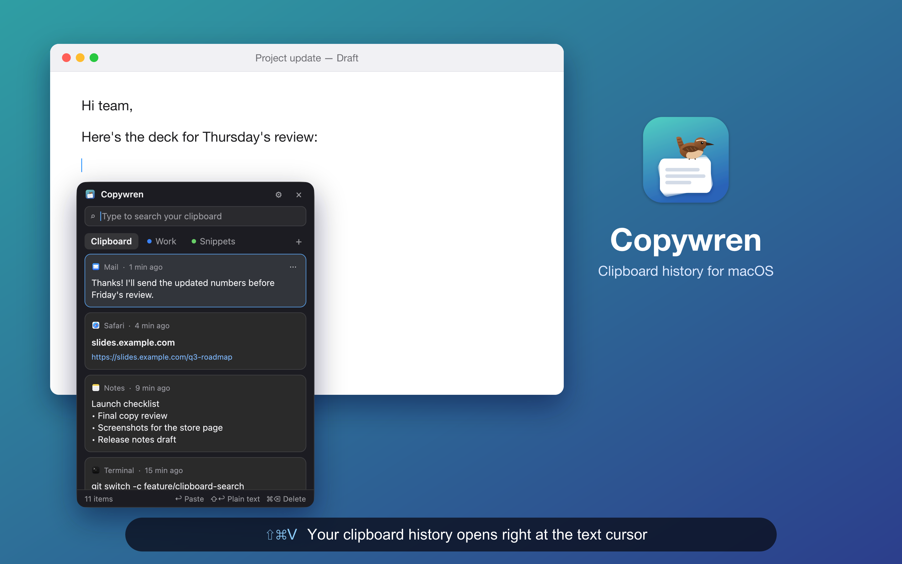
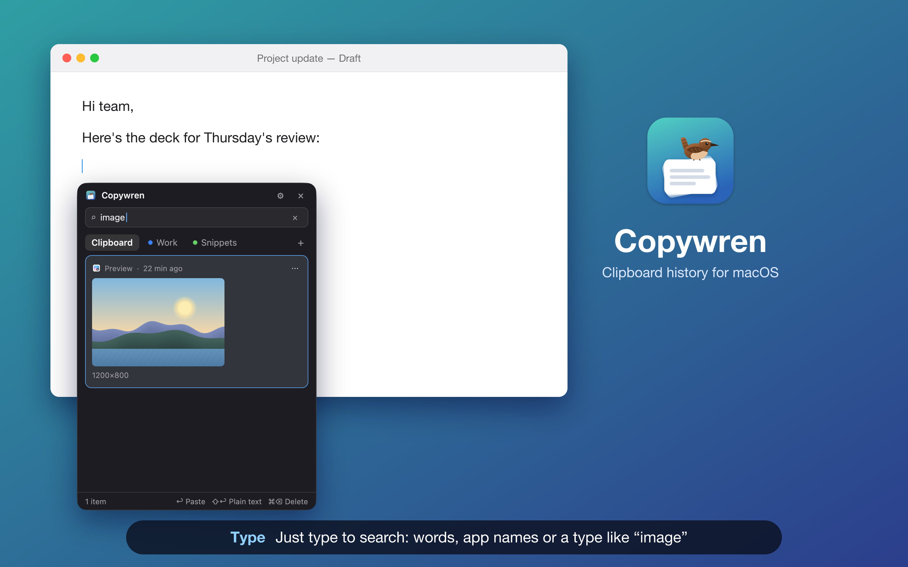
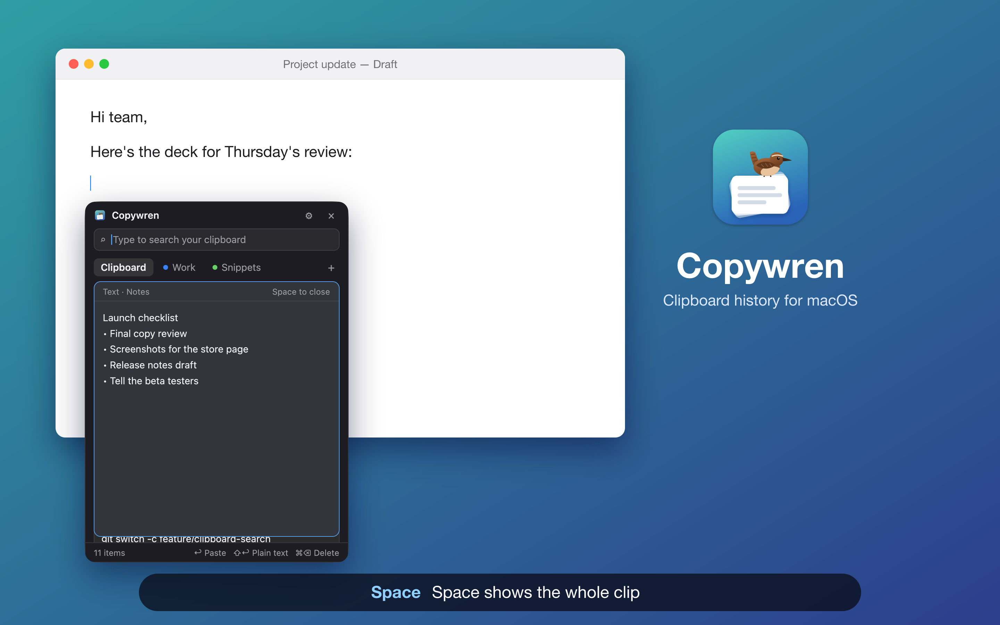
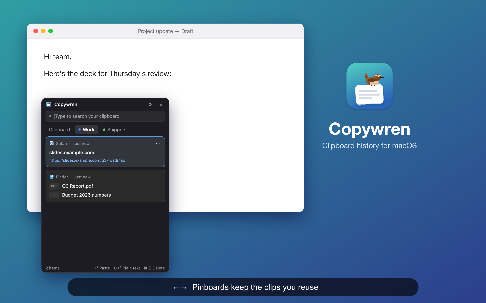
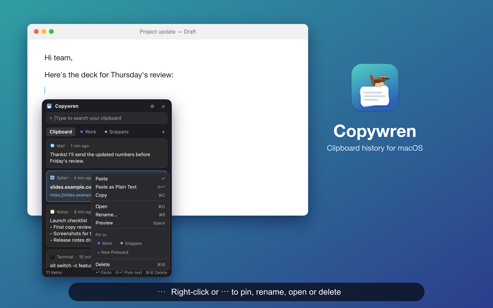
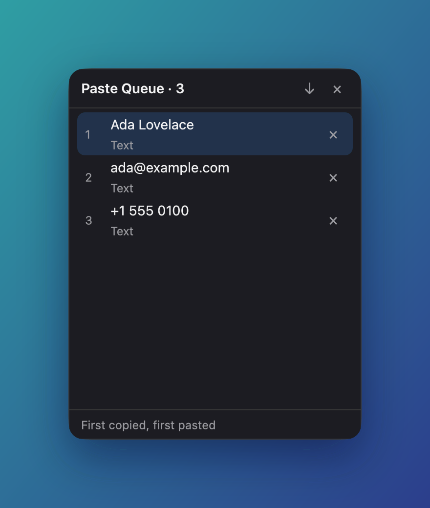
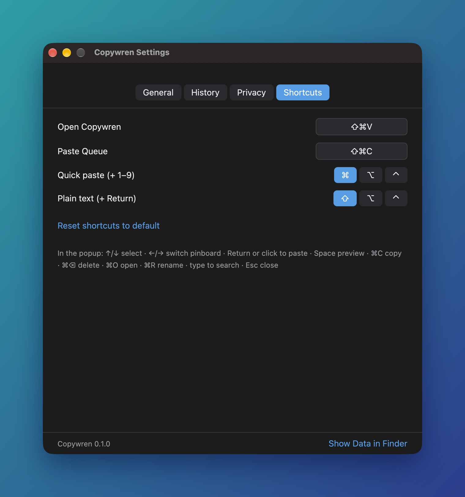

<p align="center">
  
</p>

<h1 align="center">Copywren</h1>

<p align="center">A small, fast clipboard history for macOS, written in Rust with <a href="https://gpui.rs">GPUI</a>.</p>

<p align="center">
  
  <br>
  <sub><a href="docs/demo.mp4">Watch the demo as video (MP4)</a></sub>
</p>

Copywren keeps everything you copy. Press **⇧⌘V** and a compact popup opens right at your text
cursor, so you can search your history and paste any item back into the app you're using.

## Features

- **Clipboard history** for text, links, images, files and colours. Every pasteboard type is kept, so
  a paste is as rich as the original copy. Copying the same thing again moves it to the top.
- **Opens where you type.** The popup appears just below the text cursor (or at the mouse pointer when
  an app doesn't report its cursor), stays on screen, and can be dragged by its header.
- **Keyboard first.** ↑/↓ to select, Return to paste, ⇧Return for plain text, ⌘1–⌘9 for quick paste,
  Space to preview. Clicking a card pastes it.
- **Search as you type**, with smart words. `mail link slides` finds links copied from Mail that
  mention "slides". The type words are `text`, `link`, `image`, `file` and `color`. Quote words to
  match them literally.
- **Pinboards** keep clips you reuse. Drag a card onto a tab, or use "⋯" → Pin to. Pinboards survive
  history expiry and "Erase History".
- **Paste Queue** (⇧⌘C): copy several things, then press ⌘V repeatedly to paste them in order. The
  arrow button reverses the order.
- **Private by default.** Content that password managers mark as secret or temporary is never saved,
  and you can exclude apps. The popup is hidden from screenshots and screen sharing, and capture can
  be paused from the menu bar. Everything stays on your Mac in one SQLite file.
- **History limit**: a day, a week, a month (the default), a year, or forever.

## How to use it

<table>
  <tr>
    <td width="50%"></td>
    <td width="50%"></td>
  </tr>
  <tr>
    <td><b>1. Press ⇧⌘V.</b> Your history opens just below the text cursor. Use ↑ ↓ to pick a clip and Return to paste it.</td>
    <td><b>2. Type to search.</b> Words match the text, app names match where you copied from, and <code>link</code>, <code>image</code>, <code>file</code>, <code>color</code> or <code>text</code> filter by type.</td>
  </tr>
  <tr>
    <td></td>
    <td></td>
  </tr>
  <tr>
    <td><b>3. Space previews</b> the whole clip.</td>
    <td><b>4. ← → switch to pinboards.</b> Drag a card onto a tab, or use ⋯ → Pin to, to keep it.</td>
  </tr>
  <tr>
    <td></td>
    <td></td>
  </tr>
  <tr>
    <td><b>5. Hold ⌘</b> to see quick-paste numbers. ⌘1 – ⌘9 paste straight away.</td>
    <td><b>6. Right-click or ⋯</b> to paste as plain text, open, rename, pin or delete.</td>
  </tr>
  <tr>
    <td></td>
    <td></td>
  </tr>
  <tr>
    <td><b>Paste Queue (⇧⌘C):</b> copy a few things, then press ⌘V repeatedly to paste them in order.</td>
    <td><b>Settings</b> (⌘, in the popup) let you change shortcuts, the history limit and privacy options.</td>
  </tr>
</table>

## Install from source

Requires macOS 14+, Rust 1.85+ and Xcode (GPUI compiles Metal shaders).

```sh
git clone https://github.com/sonatina-dream/copywren
cd copywren
./scripts/bundle.sh          # release build → dist/Copywren.app (ad-hoc signed)
open dist/Copywren.app
```

Copywren lives in the menu bar (the wren glyph) and has no Dock icon.

### Permissions

- **Accessibility** lets Copywren paste straight into other apps (it sends ⌘V for you) and find
  your text cursor. Without it, Return copies the item and you press ⌘V yourself. Grant it in System
  Settings → Privacy & Security → Accessibility. Because local builds are signed ad hoc, macOS may ask
  again after you rebuild.
- "Open at login" works when running `Copywren.app`.

## Keys in the popup

| Keys | Action |
|------|--------|
| ↑ ↓ · ⌘↑ ⌘↓ · Page Up/Down | Select |
| ← → · Tab | Switch between Clipboard and pinboards |
| Return · ⇧Return · click | Paste · paste as plain text · paste |
| ⌘1 … ⌘9 | Quick paste a card in view |
| ⌘C | Copy only, without pasting |
| Space | Preview |
| ⌘⌫ | Delete (or remove from pinboard) |
| ⌘O · ⌘R · ⌘N | Open link or file · rename · new pinboard |
| type, ⌫, ⌥⌫ | Search |
| Esc | Clear search, then close |

You can change the shortcuts and modifiers in Settings → Shortcuts.

## Development

```sh
cargo test --workspace                 # unit tests + headless GPUI tests of the popup
cargo run -p copywren -- --show        # start and open the popup (also: --queue, --settings)
./scripts/make-icons.sh                # re-render icons after editing assets/*.svg
./scripts/record-demo.sh               # re-record docs/demo.* and docs/screenshots
```

`record-demo.sh` builds Copywren with the `demo` feature. It fills a throw-away data directory with
invented clips, drives the popup with scripted keystrokes, and records only Copywren's own windows.
`tools/demo-render` then places those frames in a drawn scene. Your clipboard is never read or
written.

```
crates/core    platform-independent logic: model, classification, privacy, SQLite store,
               search, placement, retention, Paste Queue, settings
crates/macos   AppKit / CoreGraphics / Accessibility bindings: pasteboard, caret lookup,
               ⌘V injection, window control, menu bar item, login item
crates/app     the GPUI app: controller (state.rs), popup, Paste Queue and Settings windows
tools/         icon-render (SVG → icons) and demo-render (demo frames → video and screenshots)
SPEC.md        behavior specification
```

Data lives in `~/Library/Application Support/Copywren` (`copywren.sqlite`, `settings.json`). Set
`COPYWREN_DATA_DIR` to use another directory.

Debugging helpers:
- `cargo run -p copywren-macos --example pbtool -- save backup.bin` snapshots your clipboard, and
  `… restore backup.bin` puts it back.
- With `COPYWREN_SNAPSHOT_DIR=<dir>` set, each window writes a PNG of itself when it opens. A process
  can capture its own windows without Screen Recording permission, provided "Show during screen
  sharing" is on.

## Limitations

There's no sync between devices. The search field doesn't support input methods that compose
characters, such as dead keys or pinyin. The ⌘V that Copywren sends uses the ANSI position of the V
key. The popup is always dark.

## Support

If this app is useful to you, you can buy me a beer. Thank you! 🍺

[](https://buymeacoffee.com/sonatina_dream)

## License

[MIT](LICENSE)
